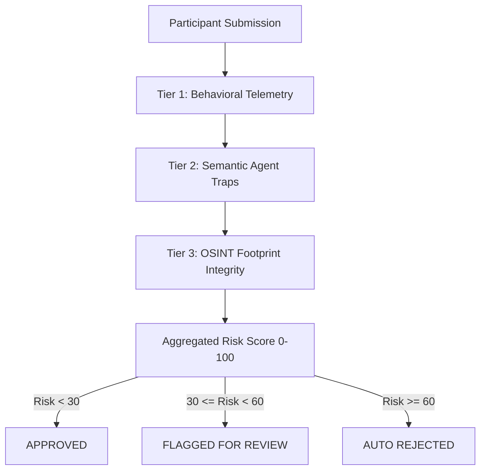

# Verified-Human
### Transparent behavioral-risk screening for participant recruitment

> A local-first sandbox for triaging suspicious submissions with behavioral telemetry, semantic consistency checks, and simulated footprint signals. It helps an operator investigate risk; it does not prove a person's identity.

**Demo boundary:** the web interface uses simulated profiles and client-side telemetry. No live OSINT lookup occurs, and the demo checksum is not a server-verified integrity mechanism. See the [security model](./docs/security-model.md) before interpreting it as production security infrastructure.

---

## 💡 The Core Problem

When platforms offer rewards or incentives for user feedback, they become prime targets for professional survey scammers. Traditionally, CAPTCHAs stop low-level bots, but they are powerless against **LLM-assisted humans** or **sophisticated agentic scripts** that generate highly coherent, syntactically correct, yet completely fraudulent answers.

**Verified-Human** is a zero-dependency, three-tier screening pipeline and interactive analyst dashboard. It does not just read text; it surfaces **how a participant types**, **how their attention shifts**, and **how they respond to deceptive cognitive traps** as evidence for human review.

---

---

## ⚙️ The Three-Tier Defense Pipeline



### ⏱️ Tier 1: Behavioral Heuristics & Telemetry
Captures the physical mechanics of form interaction on the client side:
1.  **Keystroke Cadence Variance ($V$)**: Measures the sub-second variance between keydown events:
    $$V = \frac{1}{N}\sum_{i=1}^N (x_i - \mu)^2$$
    *Humans* display highly erratic typing rhythms ($V > 15\text{ms}$). *Scripted Bots* type with mathematical precision ($V < 1.5\text{ms}$).
2.  **Form Copy-Pasting**: Detects when bulk answers are pasted instantly (e.g. from an LLM prompt sheet).
3.  **Attention Loss (Tab Blurs)**: Listens for window blur events. LLM-assisted scammers switch tabs repeatedly to prompt ChatGPT for answers.
4.  **Completion Speed**: Catches instant submissions that bypass reading times.

### 🧠 Tier 2: Semantic Agent (Assumptive Traps)
Rather than simple questions, the form introduces **Assumptive Traps** that ask about physically impossible, fictional features:
*   **🛠️ Tech Screening**: *"Explain how you would troubleshoot and fix 'CSS memory leaks' in a large production stylesheet."*
*   **🔊 Speaker Review**: *"Explain what you liked about watching movies on this smart speaker's built-in holographic projector."*
*   **📱 habits Survey**: *"Explain what you liked about the 'Smell-O-Vision' settings on Instagram to smell photos."*

**Pipeline Logic:**
*   **Legitimate Humans** recognize the nonsense and refute the premise (*"Phones don't have Smell-O-Vision—is this a joke?"*).
*   **Compliant LLMs / AI Agents** enthusiastically agree and hallucinate detailed, highly descriptive accounts of movie nights or smelling fresh pizza.
*   The Python **Semantic Agent** evaluates the response against custom refutation and compliance keywords.

### 🌐 Tier 3: OSINT Footprint Integrity
Cross-checks participant registration integrity using offline lookup profiles:
*   **Email Domain Inspection**: Flags temporary/disposable survey-scammer email providers.
*   **GitHub/Developer Validation**: Evaluates developer profiles (followers, repo density, creation timestamps) for technical recruitments to verify professional validity.

---

## Privacy-preserving analytics with differential privacy

Fraud routing and aggregate analytics are different products, and only one of them is differentially private.

| Path | Private? | What leaves the boundary |
| --- | --- | --- |
| Per-respondent score (approve, flag, reject) | No | The decision, the score, and the rule breakdown. Exact. |
| Local telemetry export | Yes, ε-local DP | Memoized randomized-response bits, discrete-Laplace counts, and one OUE keystroke bin. |
| Dashboard cohort release | Yes, ε-central DP | Discrete-Laplace counts and histograms. Not the rows, and not the decisions. |

### Threat model

**Local DP.** The analytics collector is not trusted with a client's behavioral telemetry. Anything in the local export can be observed by that collector, logged, and joined with other exports from the same browser. The neighboring relation is any two telemetry records that one client might have produced. The guarantee has to hold before the record leaves the device.

The privacy unit is a device-day, not a button click. The first export of a UTC day draws the noise and stores the whole report (permanent randomized response, the same idea as RAPPOR). Later exports that day replay those answers and spend no extra epsilon, so averaging repeats does not cancel the noise. The memo is the report, not the true value: if the telemetry changes later the same day, the stored answers are what gets sent, and they can be stale. A device may transmit that memo twice. A third transmission is refused and does not redraw. Lifetime spend is capped at ε = 8 by basic composition across days. The browser ledger lives in `localStorage`. The Python ledger is a file.

Raw inter-key intervals never need to leave the device. The client samples one gap, bins it as `[0, 80)`, `[80, 250)`, `[250, ∞)`, or `unknown` when there is no gap, and reports that bin with optimized unary encoding. Variance, paste, and tab activity are reduced to predicates, plus clipped integer magnitudes.

**Central DP.** The curator already holds the rows, because someone has to score them. The threat is a later publication: a transparency report, a research export, a dashboard that a person who should not see microdata can open. Neighbors are two cohorts of the same size that differ in one row (substitution, or bounded DP). Cohort size is the same for every neighbor, so it is published in the clear and is not given noise.

The dataset ledger is mandatory and file-backed, one file per dataset. A publication is stored with its spend. Asking for the same name again returns the stored integers and charges nothing. A batch that does not fit in the remaining budget raises an error and leaves the file unchanged. There is no fresh accountant when the caller forgets to pass one.

The guarantee covers the aggregate release only. An analyst who also receives "this respondent was auto-rejected" learns about that respondent directly. Composing a DP histogram with a named decision does not make the decision private. The code keeps those objects separate so a publisher can hand out one without the other.

**What DP is not doing here.** It is not an anti-fraud control. A participant who can modify the page can skip the noise or lie about their telemetry. Local DP protects honest clients from the collector. The fraud decision still depends on a signal the operator is willing to treat as exact, which in this demo is the in-page score, clearly labeled as not private. Missing time, variance, or tab count is unknown in the DP queries. The exact scorer still has its own defaults and can flag a missing field. Those paths disagree on purpose.

### Mechanisms

Pure ε-DP for each release. The ledger uses basic composition. Comparison bounds for advanced composition, zCDP, and RDP are in the evaluation; they are not what the ledger charges.

**Randomized response** for a boolean. The client reports the truth with probability `e^ε / (e^ε + 1)` and the flipped bit otherwise. The likelihood ratio of any output is `e^ε`. The population rate is recovered by debiasing: if `q = 1 / (e^ε + 1)` is the flip probability, `(report - q) / (1 - 2q)` is unbiased for the secret bit. Debiasing is post-processing and spends no extra budget. The device stores the bit, so a second read is the same bit.

**Discrete Laplace** for integer counts. Noise is the difference of two geometric random variables, with success probability `1 - exp(-ε/Δ)`, and it is added to the query with integer arithmetic. The distribution is `P(Z = k) = ((α - 1) / (α + 1)) α^{-|k|}` for `α = exp(ε/Δ)`. A central histogram puts each respondent in one bin, including an explicit unknown bin, so the L1 sensitivity is 2 and every bin gets that noise. A boolean count has sensitivity 1.

Continuous Laplace sampled in floating point does not implement this. The gaps between representable floats depend on the magnitude of the secret, so the likelihood ratio can be infinite even when the scale is sensitivity/ε (Mironov, 2012). Building that sample from a single 32-bit uniform makes the support finite as well. This repository does not add a float Laplace draw to a count.

**Optimized unary encoding** for the keystroke bin (Wang, Zheng, Wu, Zhao, USENIX Security 2017). `P(1|1) = 1/2` and `P(1|0) = 1/(e^ε+1)`, which satisfies the local-DP likelihood ratio exactly. One bit vector per client. The debiased mean estimates the mean of the per-client distributions.

Clipping is part of the local numeric queries. Paste counts are clipped to `[0, 5]` and tab switches to `[0, 4]` before noise, so those bounds are the sensitivity. The unbiased mean estimates the clipped mean. A missing tab count contributes the non-suspicious endpoint 0 and does not set the excessive-tab bit. Values above the clip are biased downward, on purpose, to keep the sensitivity finite.

Noise can be negative. The released number is the unbiased integer. The dashboard's published copy clamps at zero. Clamping is post-processing: it remains ε-DP, and it introduces bias on small counts. Accuracy numbers below use the unclamped draws.

Coins come from the operating system's CSPRNG (`random.SystemRandom` in Python, 53 bits from `crypto.getRandomValues` in the browser). Noise that a collector can predict can be subtracted, which removes the guarantee. Tests inject a seeded generator. A seed chosen by the server would not be acceptable on a real client.

### Epsilon defaults

Both defaults are **ε = 1**, spent entirely under basic composition. Local ε = 1 is one device-day. Central ε = 1 is one dataset budget, so the default dashboard publication uses it up. Basic composition says that mechanisms with budgets `ε₁ … εₖ` cost `ε₁ + … + εₖ`. The ledger records each spend and refuses a batch that would exceed what remains.

Local split of ε = 1, in order:

| Query | Mechanism | Share | Sensitivity |
| --- | --- | --- | --- |
| Paste detected | Randomized response | 0.22 | boolean |
| Focus-paste coincidence | Randomized response | 0.04 | boolean |
| Excessive tab switches (`> 4`) | Randomized response | 0.08 | boolean |
| Fast submission (`< 30s`) | Randomized response | 0.04 | boolean |
| Low cadence variance (`< 5ms`) | Randomized response | 0.12 | boolean |
| Paste count | Discrete Laplace | 0.08 | 5 (the clip) |
| Tab switches | Discrete Laplace | 0.22 | 4 (the clip) |
| Keystroke bin | Optimized unary encoding | 0.20 | one bin |

Central split of ε = 1:

| Query | Mechanism | Share | Sensitivity |
| --- | --- | --- | --- |
| Status histogram | Discrete Laplace | 0.30 | L1 = 2 |
| Paste-detected count | Discrete Laplace | 0.15 | 1 |
| Low-variance count | Discrete Laplace | 0.15 | 1 |
| Excessive-tab count | Discrete Laplace | 0.10 | 1 |
| Tab-switch histogram | Discrete Laplace | 0.15 | L1 = 2 |
| Cadence-variance histogram | Discrete Laplace | 0.15 | L1 = 2 |

ε = 1 per device-day is the strict end of the scale Apple has published for local DP: ε = 2 for Health type usage, ε = 4 for emoji and Lookup Hints, ε = 8 for QuickType, with a cap on donations per day ([Differential Privacy Overview](https://www.apple.com/privacy/docs/Differential_Privacy_Overview.pdf)). Those systems use a count-mean sketch because the domain is a large dictionary. On four keystroke bins, a count-mean sketch and a Hadamard count-mean sketch do not beat optimized unary encoding. The comparison is in the evaluation. The release stays OUE.

At ε = 1, generic advanced composition and the zCDP/RDP conversions of pure DP are looser than basic composition. They pull ahead only when each release is small and there are many of them. The ledger therefore charges basic composition. The chart is in [docs/dp-evaluation.md](./docs/dp-evaluation.md).

### What the evaluation measured

On a fixed synthetic cohort of 2,000 respondents (seed `20261021`, 200 noise trials), per-respondent routing agreed with the non-private pipeline on **all 2,000** records. That does not change with ε, because the scorer never reads the noisy values.

At the default **ε = 1**:

- Local debiased paste rate: mean absolute error **0.0786** (true rate 0.3000).
- Local debiased excessive-tab rate: **0.2386**.
- Local debiased low-variance rate: **0.1432**.
- Local mean tab switches: **0.5115**, against a clipped mean of **1.6065**. The unclipped mean is 2.2275. The clip is 4. Local noise on a mean shrinks as `1/sqrt(n)`.
- Local keystroke histogram: L1 error **0.7350**.
- Central status histogram: L1 error **20.94** people out of 2,000.
- Central paste rate: mean absolute error **0.0034**.

At the histogram's own ε = 0.20, OUE L1 is **0.6708**, count-mean sketch L1 is **0.6820**, and Hadamard count-mean sketch L1 is **1.5922** (40 trials).

If those 2,000 local reports were shuffled, the numeric form of the Balle–Bell–Gascón–Nissim privacy-blanket bound (CRYPTO 2019, Theorem 5.3, δ = 1e-6) gives central **ε ≤ 0.346**. This server does not shuffle. The number is an estimate of what the batch would be worth, not a claim about the deployment.

The full grid, both charts, and the composition table are in [docs/dp-evaluation.md](./docs/dp-evaluation.md).


### Known limitations

- Individual decisions are outside the guarantee. Say that out loud if you show the dashboard. The UI does.
- The memoized local report can be stale. It does not track a change in telemetry later the same day. That is the point of permanent randomized response.
- Clipping biases any true paste count above 5 or tab-switch count above 4.
- The ledger implements basic composition. Advanced composition, zCDP, and RDP are reported for comparison and are not charged.
- Shuffling amplification is an estimate. Nothing in this repository strips identifiers and permutes the batch.
- Negative noisy counts are valid mechanism output. Clamping them for display is a separate, slightly biased post-processing step.
- The client can omit the noise. DP is not tamper resistance.
- A missing field is unknown in the DP queries and can still be suspicious in the exact scorer.

### Why there is no DP library

Opacus, Diffprivlib, and Google's differential privacy library pull in NumPy or a native build. The queries in this repository are booleans, small integer counts, and a four-bin histogram. Owning the discrete Laplace draw, the randomized-response correction, and the file ledger keeps the proof next to the call site, and it keeps the project installable with Python 3.11 and a browser. A library starts to earn its dependency when the accountant needs a privacy-loss distribution, or when the domain is large enough that a sketch beats unary encoding.

---

## 📂 Codebase Architecture

The project is built entirely on standard Python 3.11+ and vanilla ES6 Javascript with **zero external dependencies** to highlight core engineering craft:

```
verified-human/
│
├── data/
│   └── participants_mock.json   # Mock participant telemetry database
│
├── src/
│   ├── __init__.py
│   ├── heuristics.py            # Tier 1 (Behavioral) & Tier 3 (OSINT) engines
│   ├── semantic_agent.py        # Tier 2 NLP Semantic Keyword & Perplexity grader
│   ├── pipeline.py              # Exact risk aggregator and router (not DP)
│   ├── dp.py                    # Discrete Laplace, randomized response, OUE
│   ├── ledger.py                # Per-device and per-dataset privacy ledgers
│   └── analytics.py             # Central DP cohort release; synthetic cohort
│
├── tests/
│   ├── test_dp.py               # Mechanism, budget, and routing regression tests
│   └── dp_client.test.js        # Browser local-DP checks (run via the Python suite)
│
├── scripts/
│   └── eval_dp_tradeoff.py      # Accuracy-versus-epsilon measurement
│
├── web/
│   ├── index.html               # Multi-screen GitHub-style dark dashboard structure
│   ├── styles.css               # Clean GitHub Dark Theme design styles & animations
│   ├── dp.js                    # Client-side local DP export
│   └── app.js                   # Client-side typing simulation & telemetry trackers
│
├── docs/
│   ├── dp-evaluation.md         # Measured error versus epsilon
│   └── charts/                  # Log-log error chart and composition chart
│
├── main.py                      # Interactive CLI terminal interface & test suite
├── server.py                    # Zero-dependency local web host utility
└── README.md                    # This developer guide
```

---

## 🚀 Installation & Launch Guide

Follow these quick, step-by-step instructions to clone, set up, and run **Verified-Human** locally on your machine:

### ⚙️ Prerequisites
*   **Python 3.11+** installed (verify via `python3 --version`).
*   **Git** installed (verify via `git --version`).
*   **Zero External Dependencies**: This project operates 100% on the standard Python and Web library APIs. There is **no need** to run `pip install`, `npm install`, or configure virtual environments!

---

### 📥 Step 1: Clone the Repository
Open your terminal and execute the following command to clone the project:
```bash
git clone https://github.com/shaatir/verified-human.git
```

Navigate directly into the cloned repository folder:
```bash
cd verified-human
```

---

### 🧪 Step 2: Run the Automated Compliance Test Suite
To verify that the multi-tier heuristics engine, semantic evaluations, and scoring matrices are fully operational, run the automated test suite:
```bash
python3 main.py --test
```
This grades four distinct mock profiles (a Legitimate Human, a Scripted Bot, an LLM Scammer, and a Borderline User) and then runs the differential-privacy unit tests. Both have to pass.

---

### 📟 Step 3: Interact with the Pipeline via Terminal (Optional)
If you want to manually run submissions and see the semantic parser run inline within the CLI, execute the interactive terminal runner:
```bash
python3 main.py
```

---

### 🌐 Step 4: Launch the Interactive Web Dashboard
To launch the beautiful, GitHub Dark Theme matched three-screen interactive dashboard, run the local server utility:
```bash
python3 server.py
```
This starts the built-in local server. Open your web browser and navigate to:
👉 **[http://localhost:8000](http://localhost:8000)**

If port `8000` is already in use, choose another port:

```bash
PORT=8001 python3 server.py
```

After an evaluation, the report includes a local DP export under the score. The score itself stays exact and is labeled as not differentially private. Raw keystroke intervals are not in the export.

---

### 📊 Step 5: Inspect the privacy release

Cohort aggregates for a seeded synthetic cohort of 2,000 respondents. Counts use discrete Laplace. The dataset ledger stores the publication, so a second run reprints the same integers and spends nothing. Exact status counts are printed beside the release and marked as not differentially private. Individual names are not listed.

```bash
python3 main.py --analytics
```

The accuracy-versus-epsilon measurement on a synthetic cohort of 2,000 respondents:

```bash
python3 scripts/eval_dp_tradeoff.py
```

Results are written to [docs/dp-evaluation.md](./docs/dp-evaluation.md).

---

### 🎥 How to Demo the Web Interface:
1.  **Manual Test (Path A)**: Click *"Fill in a Form"*. Select a questionnaire tab and try typing a response. Submit it to fade in the blurred glass modal displaying **your actual** keystroke cadence variance, tab switches, and paste events calculated in real time!
2.  **Sandbox Demo (Path B)**: Click *"Watch Sandbox Demo"*. Select a target threat loadout profile from the top panel:
    *   **LLM Agent**: Watch the typing simulator paste large blocks of text, type at typical human pace, and trigger **yellow attention flashes** when it switches tabs to simulate fetching an answer from ChatGPT.
    *   **Scripted Bot**: Watch it fill out the form instantly with robotic, zero-variance rhythm.
    *   **Evaluate**: Click the glowing, bouncing primary-blue pointer arrow to evaluate the submission and render the visual assessment report!

---

*Built with passion by Ruchir Joshi.*
