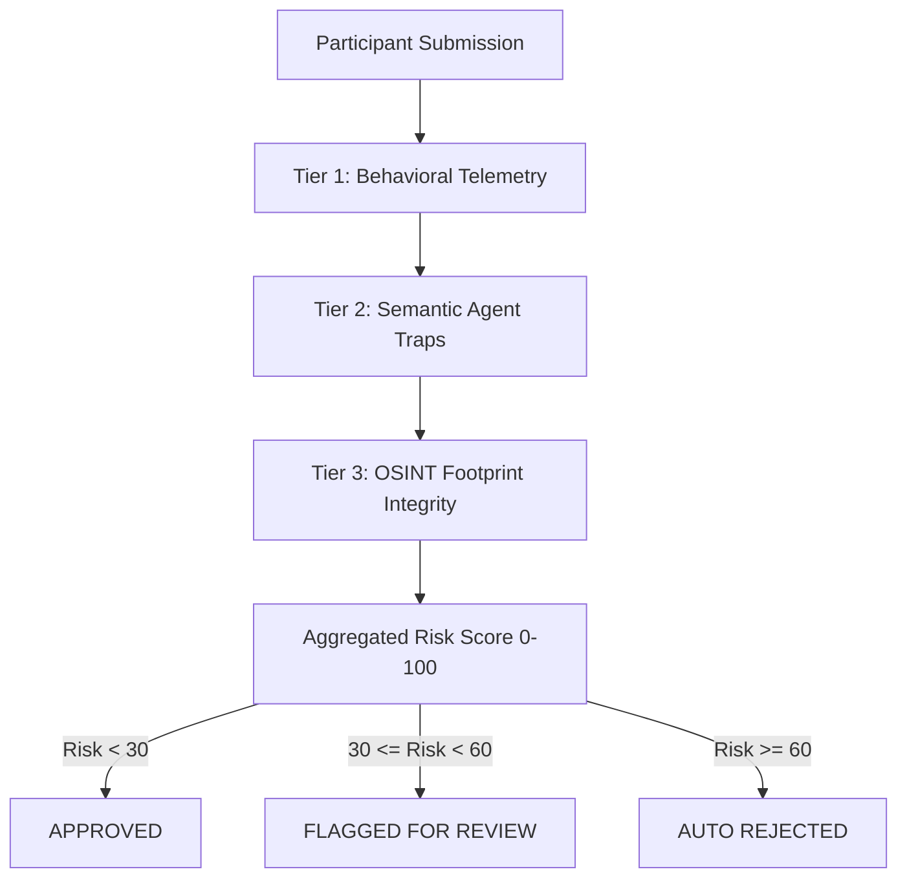

# Verified-Human
### Transparent behavioral-risk screening for participant recruitment

> A local-first sandbox for triaging suspicious submissions with behavioral telemetry, semantic consistency checks, and simulated footprint signals. It helps an operator investigate risk; it does not prove a person's identity.

**Demo boundary:** the web interface uses simulated profiles and client-side telemetry. No live OSINT lookup occurs, and the demo checksum is not a server-verified integrity mechanism. See the [security model](./docs/security-model.md) before interpreting it as production security infrastructure.

---

## 💡 The Core Problem

When platforms offer rewards or incentives for user feedback, they become prime targets for professional survey scammers. Traditionally, CAPTCHAs stop low-level bots, but they are powerless against **LLM-assisted humans** or **sophisticated agentic scripts** that generate highly coherent, syntactically correct, yet completely fraudulent answers.

**Verified-Human** is a zero-dependency, three-tier screening pipeline and interactive analyst dashboard. It does not just read text; it surfaces **how a participant types**, **how their attention shifts**, and **how they respond to deceptive cognitive traps** as evidence for human review.

---

---

## ⚙️ The Three-Tier Defense Pipeline



### ⏱️ Tier 1: Behavioral Heuristics & Telemetry
Captures the physical mechanics of form interaction on the client side:
1.  **Keystroke Cadence Variance ($V$)**: Measures the sub-second variance between keydown events:
    $$V = \frac{1}{N}\sum_{i=1}^N (x_i - \mu)^2$$
    *Humans* display highly erratic typing rhythms ($V > 15\text{ms}$). *Scripted Bots* type with mathematical precision ($V < 1.5\text{ms}$).
2.  **Form Copy-Pasting**: Detects when bulk answers are pasted instantly (e.g. from an LLM prompt sheet).
3.  **Attention Loss (Tab Blurs)**: Listens for window blur events. LLM-assisted scammers switch tabs repeatedly to prompt ChatGPT for answers.
4.  **Completion Speed**: Catches instant submissions that bypass reading times.

### 🧠 Tier 2: Semantic Agent (Assumptive Traps)
Rather than simple questions, the form introduces **Assumptive Traps** that ask about physically impossible, fictional features:
*   **🛠️ Tech Screening**: *"Explain how you would troubleshoot and fix 'CSS memory leaks' in a large production stylesheet."*
*   **🔊 Speaker Review**: *"Explain what you liked about watching movies on this smart speaker's built-in holographic projector."*
*   **📱 habits Survey**: *"Explain what you liked about the 'Smell-O-Vision' settings on Instagram to smell photos."*

**Pipeline Logic:**
*   **Legitimate Humans** recognize the nonsense and refute the premise (*"Phones don't have Smell-O-Vision—is this a joke?"*).
*   **Compliant LLMs / AI Agents** enthusiastically agree and hallucinate detailed, highly descriptive accounts of movie nights or smelling fresh pizza.
*   The Python **Semantic Agent** evaluates the response against custom refutation and compliance keywords.

### 🌐 Tier 3: OSINT Footprint Integrity
Cross-checks participant registration integrity using offline lookup profiles:
*   **Email Domain Inspection**: Flags temporary/disposable survey-scammer email providers.
*   **GitHub/Developer Validation**: Evaluates developer profiles (followers, repo density, creation timestamps) for technical recruitments to verify professional validity.

---

## Privacy-preserving analytics with differential privacy

Fraud routing and aggregate analytics are different products, and only one of them is differentially private.

| Path | Private? | What leaves the boundary |
| --- | --- | --- |
| Per-respondent score (approve, flag, reject) | No | The decision, the score, and the rule breakdown. Exact. |
| Local telemetry export | Yes, ε-local DP | Noisy predicates, a clipped paste count, a clipped tab-switch count, and a noisy keystroke-gap histogram. |
| Dashboard cohort release | Yes, ε-central DP | Noisy counts and histograms. Not the rows, and not the decisions. |

### Threat model

**Local DP.** The analytics collector is not trusted with a client's behavioral telemetry. Anything in the local export can be observed by that collector, logged, and joined with other exports from the same browser. The neighboring relation is any two telemetry records that one client might have produced. The guarantee has to hold before the record leaves the device.

Raw inter-key intervals never need to leave the device for this report. The client turns them into a five-bin histogram (`[0, 50)`, `[50, 150)`, `[150, 300)`, `[300, 600)`, `[600, ∞)` milliseconds) and adds noise there. Variance, paste, and tab activity are reduced to the same predicates the Tier 1 rules already use, plus clipped magnitudes.

**Central DP.** The curator already holds the rows, because someone has to score them. The threat is a later publication: a transparency report, a research export, a dashboard that a person who should not see microdata can open. Neighbors are two cohorts of the same size that differ in one row (substitution, or bounded DP). Cohort size is the same for every neighbor, so it is published in the clear and is not given noise.

The guarantee covers the aggregate release only. An analyst who also receives "this respondent was auto-rejected" learns about that respondent directly. Composing a DP histogram with a named decision does not make the decision private. The code keeps those objects separate so a publisher can hand out one without the other.

**What DP is not doing here.** It is not an anti-fraud control. A participant who can modify the page can skip the noise or lie about their telemetry. Local DP protects honest clients from the collector. The fraud decision still depends on a signal the operator is willing to treat as exact, which in this demo is the in-page score, clearly labeled as not private.

### Mechanisms

Pure ε-DP. No δ. Two mechanisms, both in the standard library (`src/dp.py`) and, for the local export, in `web/dp.js`.

**Randomized response** for a boolean. The client reports the truth with probability `e^ε / (e^ε + 1)` and the flipped bit otherwise. The likelihood ratio of any output is `e^ε`, which is the local DP definition. The population rate is recovered by debiasing: if `q = 1 / (e^ε + 1)` is the flip probability, `(report - q) / (1 - 2q)` is unbiased for the secret bit. Debiasing is post-processing and spends no extra budget. It is high-variance when ε is small, because the denominator is `tanh(ε / 2)`.

**Laplace mechanism** for numeric queries. A query with sensitivity `Δ` gets noise from the distribution with density `(1 / 2b) exp(-|x| / b)` and `b = Δ / ε`. A histogram is a vector. If its L1 sensitivity is `Δ₁`, independent Laplace(`Δ₁ / ε`) noise on every bin is ε-DP for the whole vector, not `(number of bins) × ε`. The ledger charges the histogram once. The keystroke histogram's L1 sensitivity is 2, because a per-client distribution (or the zero vector, if they never typed) moves by at most 2 when that client changes arbitrarily. A central histogram that places each respondent in exactly one bin also has L1 sensitivity 2 under substitution. A boolean count has sensitivity 1.

Clipping is part of the query. Paste counts are clipped to `[0, 5]` and tab switches to `[0, 10]` before local noise, so those bounds are the sensitivity. The unbiased mean estimates the clipped mean. Values above the clip are biased downward, on purpose, to keep the sensitivity finite.

Noise can be negative. The released number is the unbiased draw. The dashboard's published copy clamps at zero. Clamping is post-processing: it remains ε-DP, and it introduces bias on small counts. Accuracy numbers below use the unclamped draws.

Coins come from the operating system's CSPRNG (`random.SystemRandom` in Python, `crypto.getRandomValues` in the browser). Laplace noise that a collector can predict can be subtracted, which removes the guarantee. Tests inject a seeded generator. A seed chosen by the server would not be acceptable on a real client.

### Epsilon defaults

Both defaults are **ε = 1** for one release, spent entirely under basic composition. Basic composition says that running mechanisms with budgets `ε₁ … εₖ` costs `ε₁ + … + εₖ`. The accountant records each spend and refuses a query that would exceed the budget declared for that accountant. It does not implement zCDP or a privacy-loss distribution. Those give tighter bounds when you run many queries; with a handful of queries, basic composition is the bound you can defend on a whiteboard, and it is conservative.

Local split of ε = 1, in order:

| Query | Mechanism | Share | Sensitivity |
| --- | --- | --- | --- |
| Paste detected | Randomized response | 0.25 | boolean |
| Focus-paste coincidence | Randomized response | 0.08 | boolean |
| Excessive tab switches (`> 4`) | Randomized response | 0.20 | boolean |
| Fast submission (`< 30s`) | Randomized response | 0.07 | boolean |
| Low cadence variance (`< 5ms`) | Randomized response | 0.15 | boolean |
| Paste count | Laplace | 0.05 | 5 (the clip) |
| Tab switches | Laplace | 0.10 | 10 (the clip) |
| Keystroke-gap histogram | Vector Laplace | 0.10 | L1 = 2 |

Central split of ε = 1:

| Query | Mechanism | Share | Sensitivity |
| --- | --- | --- | --- |
| Status histogram | Vector Laplace | 0.30 | L1 = 2 |
| Paste-detected count | Laplace | 0.15 | 1 |
| Low-variance count | Laplace | 0.15 | 1 |
| Excessive-tab count | Laplace | 0.10 | 1 |
| Tab-switch histogram | Vector Laplace | 0.15 | L1 = 2 |
| Cadence-variance histogram | Vector Laplace | 0.15 | L1 = 2 |

ε = 1 is a strict default, not a claim that the whole product is "private." Apple's public local-DP overview uses per-donation budgets on this same scale: ε = 2 for Health type usage, ε = 4 for emoji and Lookup Hints, ε = 8 for QuickType, with a cap on donations per day ([Differential Privacy Overview](https://www.apple.com/privacy/docs/Differential_Privacy_Overview.pdf)). Those systems also use a count-mean sketch, because the domain is a large dictionary. This telemetry domain is a few booleans and a five-bin histogram. A sketch would add collision error and would not reduce a communication cost we do not have. Randomized response and Laplace match the queries.

Pass another ε into `local_dp_release` or `central_dashboard_release` when a product decision spends more. The shares scale with it, and the accountant still sums to that ε. Two publications compose only if you pass the same accountant. A fresh accountant does not remember the previous release. That is a real footgun, and it is why the ledger is part of the release object.

### What the evaluation measured

On a fixed synthetic cohort of 2,000 respondents (seed `20261021`, 30 noise trials), per-respondent routing agreed with the non-private pipeline on **all 2,000** records. That does not change with ε, because the scorer never reads the noisy values.

At the default **ε = 1**:

- Local debiased paste rate: mean absolute error **0.077**.
- Local debiased excessive-tab rate: **0.073**.
- Local debiased low-variance rate: **0.114**.
- Local mean tab switches: **2.49**, against a true clipped mean of **2.23**. The Laplace scale on that query is 100, and local noise averages down as `1/sqrt(n)`, so ε = 1 does not resolve the mean.
- Local keystroke histogram: L1 error **2.68**, larger than a distribution that sums to 1.
- Central status histogram: L1 error **20.0** people out of 2,000.
- Central paste rate: mean absolute error **0.004**.

At ε = 8 the local tab-switch MAE falls to **0.32** and the histogram L1 to **0.35**. The full grid, the bias check, and the four-person mock cohort (where central noise is larger than the cohort) are in [docs/dp-evaluation.md](./docs/dp-evaluation.md).

### Known limitations

- Individual decisions are outside the guarantee. Say that out loud if you show the dashboard. The UI does.
- Local numeric queries at ε = 1 are high-variance. The boolean rates are the usable local statistics at the default budget. Magnitudes want either central DP, a larger cohort, or a larger ε.
- Clipping biases any true paste count above 5 or tab-switch count above 10.
- The accountant implements basic composition only. It cannot see a release you forgot to record.
- No privacy amplification from shuffling is claimed. A shuffled batch of local reports can sometimes be analyzed as central DP. This code does not take that credit.
- Negative noisy counts are valid mechanism output. Clamping them for display is a separate, slightly biased post-processing step.
- The client can omit the noise. DP is not tamper resistance.
- The mock cohort has four people. `python3 main.py --analytics` is a demonstration of the release format, not a prevalence.

### Why there is no DP library

Opacus, Diffprivlib, and Google's differential privacy library pull in NumPy or a native build. The queries in this repository are booleans, counts, and histograms with at most five bins. Owning the Laplace draw, the randomized-response correction, and the accountant keeps the proof next to the call site, and it keeps the project installable with Python 3.11 and a browser. A library starts to earn its dependency when the accountant needs zCDP or privacy-loss distributions, or when the domain is large enough for a sketch.

---

## 📂 Codebase Architecture

The project is built entirely on standard Python 3.11+ and vanilla ES6 Javascript with **zero external dependencies** to highlight core engineering craft:

```
verified-human/
│
├── data/
│   └── participants_mock.json   # Mock participant telemetry database
│
├── src/
│   ├── __init__.py
│   ├── heuristics.py            # Tier 1 (Behavioral) & Tier 3 (OSINT) engines
│   ├── semantic_agent.py        # Tier 2 NLP Semantic Keyword & Perplexity grader
│   ├── pipeline.py              # Exact risk aggregator and router (not DP)
│   ├── dp.py                    # Laplace, randomized response, privacy accountant
│   └── analytics.py             # Central DP cohort release; synthetic cohort
│
├── tests/
│   ├── test_dp.py               # Mechanism, budget, and routing regression tests
│   └── dp_client.test.js        # Browser local-DP checks (run via the Python suite)
│
├── scripts/
│   └── eval_dp_tradeoff.py      # Accuracy-versus-epsilon measurement
│
├── web/
│   ├── index.html               # Multi-screen GitHub-style dark dashboard structure
│   ├── styles.css               # Clean GitHub Dark Theme design styles & animations
│   ├── dp.js                    # Client-side local DP export
│   └── app.js                   # Client-side typing simulation & telemetry trackers
│
├── docs/
│   └── dp-evaluation.md         # Measured error versus epsilon
│
├── main.py                      # Interactive CLI terminal interface & test suite
├── server.py                    # Zero-dependency local web host utility
└── README.md                    # This developer guide
```

---

## 🚀 Installation & Launch Guide

Follow these quick, step-by-step instructions to clone, set up, and run **Verified-Human** locally on your machine:

### ⚙️ Prerequisites
*   **Python 3.11+** installed (verify via `python3 --version`).
*   **Git** installed (verify via `git --version`).
*   **Zero External Dependencies**: This project operates 100% on the standard Python and Web library APIs. There is **no need** to run `pip install`, `npm install`, or configure virtual environments!

---

### 📥 Step 1: Clone the Repository
Open your terminal and execute the following command to clone the project:
```bash
git clone https://github.com/shaatir/verified-human.git
```

Navigate directly into the cloned repository folder:
```bash
cd verified-human
```

---

### 🧪 Step 2: Run the Automated Compliance Test Suite
To verify that the multi-tier heuristics engine, semantic evaluations, and scoring matrices are fully operational, run the automated test suite:
```bash
python3 main.py --test
```
This grades four distinct mock profiles (a Legitimate Human, a Scripted Bot, an LLM Scammer, and a Borderline User) and then runs the differential-privacy unit tests. Both have to pass.

---

### 📟 Step 3: Interact with the Pipeline via Terminal (Optional)
If you want to manually run submissions and see the semantic parser run inline within the CLI, execute the interactive terminal runner:
```bash
python3 main.py
```

---

### 🌐 Step 4: Launch the Interactive Web Dashboard
To launch the beautiful, GitHub Dark Theme matched three-screen interactive dashboard, run the local server utility:
```bash
python3 server.py
```
This starts the built-in local server. Open your web browser and navigate to:
👉 **[http://localhost:8000](http://localhost:8000)**

If port `8000` is already in use, choose another port:

```bash
PORT=8001 python3 server.py
```

After an evaluation, the report includes a local DP export under the score. The score itself stays exact and is labeled as not differentially private. Raw keystroke intervals are not in the export.

---

### 📊 Step 5: Inspect the privacy release

Cohort aggregates, with Laplace noise and a privacy-budget ledger. The exact decisions are printed beside the release and marked as not differentially private. With four mock respondents the noise is larger than the cohort; that is the point of the warning.

```bash
python3 main.py --analytics
```

The accuracy-versus-epsilon measurement on a synthetic cohort of 2,000 respondents:

```bash
python3 scripts/eval_dp_tradeoff.py
```

Results are written to [docs/dp-evaluation.md](./docs/dp-evaluation.md).

---

### 🎥 How to Demo the Web Interface:
1.  **Manual Test (Path A)**: Click *"Fill in a Form"*. Select a questionnaire tab and try typing a response. Submit it to fade in the blurred glass modal displaying **your actual** keystroke cadence variance, tab switches, and paste events calculated in real time!
2.  **Sandbox Demo (Path B)**: Click *"Watch Sandbox Demo"*. Select a target threat loadout profile from the top panel:
    *   **LLM Agent**: Watch the typing simulator paste large blocks of text, type at typical human pace, and trigger **yellow attention flashes** when it switches tabs to simulate fetching an answer from ChatGPT.
    *   **Scripted Bot**: Watch it fill out the form instantly with robotic, zero-variance rhythm.
    *   **Evaluate**: Click the glowing, bouncing primary-blue pointer arrow to evaluate the submission and render the visual assessment report!

---

*Built with passion by Ruchir Joshi.*
