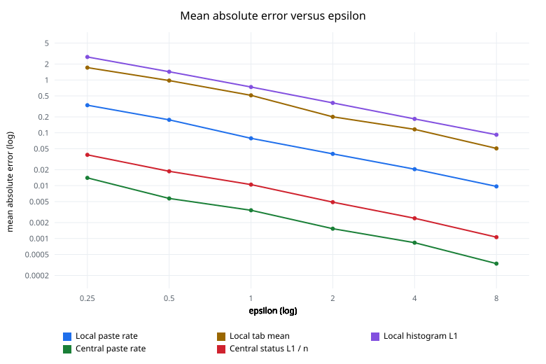
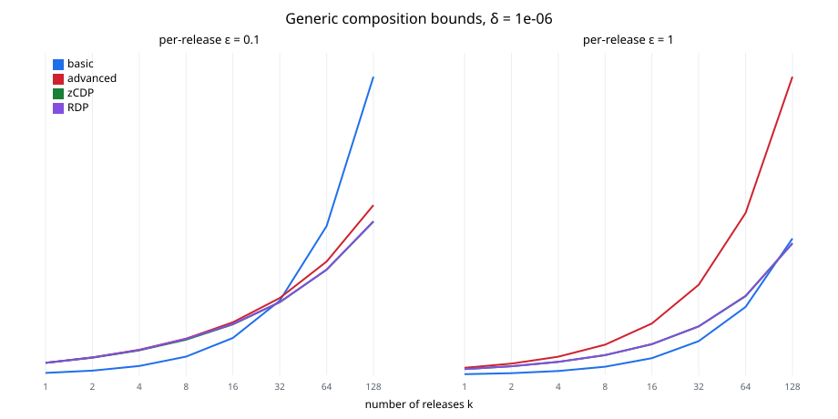

# Differential privacy evaluation

Synthetic cohort of 2000 respondents, seed `20261021`, 200 independent noise trials.
Per-respondent routing agreed with the labeled role on **2000 / 2000** records. The scorer does not read the noisy values, so that agreement does not depend on epsilon.

Each local trial draws the mechanism once per client. A device ledger would store that draw for the UTC day and replay it. Repeats are not averaged here, because averaging memoized answers would not remove noise and averaging fresh draws would.

Central trials are separate single publications. They are not sequential spends of one dataset ledger. The default dataset budget is ε = 1, so one dashboard publication exhausts it and a rerun replays the stored integers.

Error on a mean of n local reports falls like `1/sqrt(n)`, not `1/n`. Discrete Laplace on a clipped integer has variance `2(1-p)/p²` with `p = 1 - exp(-ε/Δ)`. The standard deviation of the mean is that standard deviation divided by `sqrt(n)`.

## Accuracy versus epsilon

Local tab error is against the mean after clipping to `[0, 4]`. The clipped mean is **1.6065**. The unclipped mean is **2.2275**. Values above the clip, including the synthetic LLM and borderline tab counts, are biased downward on purpose so the sensitivity stays finite.

True paste rate **0.3000**, excessive-tab rate **0.2500**, low-variance rate **0.1500**.

| ε | local paste MAE | local excessive-tab MAE | local low-variance MAE | local tab MAE | local histogram L1 | central paste MAE | central status L1 |
| ---: | ---: | ---: | ---: | ---: | ---: | ---: | ---: |
| 0.25 | 0.3327 | 0.8935 | 0.6087 | 1.7149 | 2.7221 | 0.0141 | 76.6850 |
| 0.5 | 0.1759 | 0.4714 | 0.2809 | 0.9755 | 1.4327 | 0.0057 | 37.4600 |
| 1 | 0.0786 | 0.2386 | 0.1432 | 0.5115 | 0.7350 | 0.0034 | 20.9350 |
| 2 | 0.0399 | 0.1191 | 0.0658 | 0.2008 | 0.3678 | 0.0015 | 9.7500 |
| 4 | 0.0205 | 0.0537 | 0.0324 | 0.1164 | 0.1834 | 0.0008 | 4.8350 |
| 8 | 0.0097 | 0.0257 | 0.0187 | 0.0507 | 0.0919 | 0.0003 | 2.1200 |

The chart is log-log. Central status error is plotted as L1 divided by cohort size so it shares an axis with the rates. The table keeps the L1 in people.

At the default ε = 1 the local paste MAE is **0.0786**, the clipped tab-switch MAE is **0.5115**, and the keystroke histogram L1 is **0.7350**. Central paste-rate MAE is **0.0034** and the status histogram L1 is **20.9350** people.

## Histogram mechanisms

The release uses optimized unary encoding (Wang, Zheng, Wu, Zhao, USENIX Security 2017) on four bins: `[0, 80)`, `[80, 250)`, `[250, ∞)`, and `unknown`. One uniformly sampled gap per client. No gaps is the unknown bin. The estimand is the mean of the per-client distributions.

Count-mean sketch and Hadamard count-mean sketch (Apple, Learning with Privacy at Scale) are a benchmark at the histogram's share of ε = 1, which is ε = 0.2000. 40 trials, same sampled items, error against that empirical one-hot mean:

| mechanism | L1 |
| --- | ---: |
| OUE (the release) | 0.6708 |
| CMS, width 32, depth 8 | 0.6820 |
| HCMS, width 8 | 1.5922 |

CMS lands next to OUE. HCMS is worse: a Hadamard row is a compression step for a large domain, and four bins do not need it. The release stays OUE.

## Composition

These are generic bounds for composing pure ε-DP mechanisms. They are not a privacy-loss distribution of discrete Laplace. δ = 1e-6.

Basic composition is `kε`. Advanced composition (Dwork, Rothblum, Vadhan) is `sqrt(2 k ln(1/δ)) ε + k ε (e^ε - 1)`. At ε = 1 that bound is looser than basic composition, including at k = 1. zCDP (Bun, Steinke) uses ρ = ε²/2 per release. RDP uses the same pure-DP curve, (α, α ε²/2), minimized over α. When the per-release epsilon is small, zCDP and RDP beat basic composition as k grows. The dataset ledger still records basic composition, which is valid at the default ε = 1 and does not depend on a δ.

| k | per-release ε | basic | advanced | zCDP | RDP |
| ---: | ---: | ---: | ---: | ---: | ---: |
| 1 | 0.1 | 0.1000 | 0.5362 | 0.5307 | 0.5339 |
| 2 | 0.1 | 0.2000 | 0.7644 | 0.7534 | 0.7657 |
| 4 | 0.1 | 0.4000 | 1.0934 | 1.0713 | 1.0807 |
| 8 | 0.1 | 0.8000 | 1.5709 | 1.5268 | 1.5607 |
| 16 | 0.1 | 1.6000 | 2.2709 | 2.1826 | 2.2010 |
| 32 | 0.1 | 3.2000 | 3.3101 | 3.1335 | 3.1351 |
| 64 | 0.1 | 6.4000 | 4.8783 | 4.5252 | 4.5336 |
| 128 | 0.1 | 12.8000 | 7.2933 | 6.5871 | 6.6031 |
| 1 | 1 | 1.0000 | 6.9748 | 5.7565 | 5.7631 |
| 2 | 1 | 2.0000 | 10.8704 | 8.4338 | 8.4539 |
| 4 | 1 | 4.0000 | 17.3862 | 12.5130 | 12.6052 |
| 8 | 1 | 8.0000 | 28.6139 | 18.8677 | 18.9078 |
| 16 | 1 | 16.0000 | 48.5186 | 29.0261 | 29.2103 |
| 32 | 1 | 32.0000 | 84.7204 | 45.7354 | 45.8155 |
| 64 | 1 | 64.0000 | 152.0222 | 74.0522 | 74.4207 |
| 128 | 1 | 128.0000 | 279.4108 | 123.4708 | 123.6310 |

## Amplification by shuffling

This repository does not shuffle reports. The bound below is what Theorem 5.3 of Balle, Bell, Gascón, and Nissim (CRYPTO 2019, The Privacy Blanket of the Shuffle Model) proves for a shuffled batch of n ε-local reports, with C = 1 - e^{-2}. It is an upper bound on a central epsilon, solved numerically. It is not a property of the server.

For the composed local report at ε = 1, n = 2000, δ = 1e-06, the numeric bound is central **ε ≤ 0.3460**.

The whole local report is one ε-local message under basic composition of its queries, so the local epsilon in the formula is 1, not the share of a single predicate.

## Mechanisms and the float issue

Integer counts use discrete Laplace: the difference of two geometric random variables, added to the integer query with integer arithmetic. Sampling continuous Laplace noise in floating point and adding it to a secret does not implement the Laplace mechanism. The gaps between representable values depend on the magnitude of the secret, so the likelihood ratio can be infinite (Mironov, 2012). A single 32-bit uniform through the inverse CDF makes the support finite as well. This code does not do that.

Missing time, missing variance, and a missing tab count are unknown. In the local predicates they are not treated as fast, low-variance, or excessive. In the central histograms they fall in an explicit unknown bin. The exact fraud scorer still uses its own defaults and can flag a missing field. Those paths are different on purpose.

